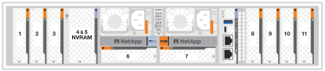

= Infórmate sobre cómo añadir y sustituir módulos de E/S en un sistema AFF C80
:allow-uri-read: 
:icons: font
:imagesdir: ../media/

[role="lead"]
El sistema AFF C80 ofrece flexibilidad a la hora de ampliar o sustituir módulos de E/S para mejorar la conectividad de red y el rendimiento. Añadir un módulo de E/S es fundamental a la hora de actualizar las capacidades de red. Sustituir un módulo de E/S es fundamental cuando hay que solucionar el fallo de un módulo.

Puede sustituir un módulo de I/O con fallo en el sistema de almacenamiento AFF C80 por el mismo tipo de módulo de I/O o por otro tipo de módulo de I/O diferente. También puede agregar un módulo de E/S a un sistema con ranuras vacías.

* link:io-module-add.html["Agregue un módulo de E/S."]
+
La adición de módulos adicionales puede mejorar la redundancia, lo que ayuda a garantizar que el sistema siga funcionando incluso si falla un módulo.

* link:io-module-hotswap.html["Intercambia en caliente un módulo de E/S"]
+
El intercambio en caliente de un módulo de E/S te permite reemplazar un módulo averiado sin apagar el sistema, minimizando el tiempo de inactividad y manteniendo la disponibilidad del sistema.

* link:io-module-replace.html["Sustituya un módulo de E/S."]
+
El reemplazo de un módulo de E/S que falla puede restaurar el sistema a su estado operativo óptimo.

.Numeración de ranuras de E/S.
Las ranuras de I/O de las controladoras AFF C80 están numeradas de 1 a 11, como se muestra en la ilustración siguiente.

